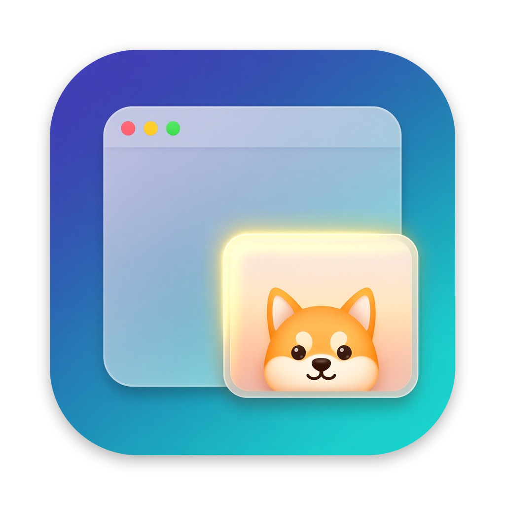

<p align="center"></p>
<h1 align="center">PipDog</h1>
<p align="center"><b>Picture-in-picture for any window on your Mac, or just the part of it you care about.</b></p>
<p align="center"><a href="https://github.com/aliyoge/PipDog/releases/latest">Download</a> · <a href="#getting-started">Getting started</a> · <a href="#usage">Usage</a> · <a href="#faq">FAQ</a></p>
<p align="center">English · <a href="README.zh-CN.md">简体中文</a></p>
<p align="center">
  
  
  <a href="LICENSE"></a>
</p>

<!-- Screenshot / GIF: add one here when available (e.g. docs/images/demo.gif). -->

PipDog lives in the menu bar and turns any window, or any region of a window, into a small live floating window that stays on top on every Space. Keep an eye on a build log, a chat, a video or a dashboard while you work in something else.

- **Any window, any region.** PiP the focused window with a hotkey, drag out a region, or hold a modifier and double-click a panel (a log view, a chat list) to PiP just that element.
- **Back to the source in one click.** Double-click the PiP (or single-click, your choice) to bring the original window to the front. Do it again and PipDog tucks the window away at the screen edge, where it keeps updating, until you call it back.
- **Zoom, peek, fade.** Scroll or pinch to zoom up to 8×, ⌥-click for a full-resolution Quick Look snapshot, set the opacity, or let the PiP fade out and pass clicks through while the pointer rests on it.
- **Stays out of your way.** PiPs never take keyboard focus, capture only at the resolution they are shown at, and refresh at 10 fps by default (5 to 60 fps).
- **Native and private.** Swift, AppKit and ScreenCaptureKit, public APIs only. No account and no network access: nothing leaves your Mac.
- **Free and open source** under the Apache-2.0 license.

> PipDog is available in English and Simplified Chinese. It follows your macOS language by default; you can change it in **Settings… › General › Language**.

## Getting started

### Requirements

| | |
| --- | --- |
| **macOS** | macOS 14 Sonoma or later |
| **Mac** | Apple silicon or Intel (universal build) |

### 1. Install

1. Download `PipDog-<version>.dmg` (or `.zip`) from the [latest release](https://github.com/aliyoge/PipDog/releases/latest).
2. Open the disk image and drag **PipDog** to **Applications**. Launch at login only works from the Applications folder.
3. Open PipDog. Its icon appears in the menu bar; there is no Dock icon.

> [!IMPORTANT]
> **"PipDog" is damaged and can't be opened / "PipDog" can't be opened because Apple cannot check it for malicious software**
>
> PipDog isn't notarized by Apple yet, so macOS Gatekeeper blocks it on first launch. The app is fine. Pick either fix:
>
> **Option 1: Terminal (recommended, works on every macOS version)**
>
> ```bash
> xattr -cr /Applications/PipDog.app
> ```
>
> Then open PipDog again. This removes the quarantine flag macOS adds to downloaded files.
>
> **Option 2: System Settings**
>
> 1. Open PipDog once and close the warning.
> 2. Go to **System Settings › Privacy & Security**, scroll down to **Security**, and click **Open Anyway** next to the PipDog message.
> 3. Confirm with **Open Anyway** and enter your password.
>
> On macOS 14 you can also Control-click PipDog in Applications and choose **Open**.

### 2. Grant permissions when asked

PipDog asks for nothing at launch. Each permission is requested the first time you use a feature that needs it.

| Permission | Needed for |
| --- | --- |
| **Screen Recording** (called **Screen & System Audio Recording** on macOS 15 and later) | Required. Shows the live content of the window in the PiP. Requested on your first PiP. After granting it, restart PipDog: it offers a **Relaunch PipDog** button. |
| **Accessibility** | Optional. Modifier + double-click, raising the exact source window (not just its app), moving the source window to the screen edge, and telling when a source window is minimized. Requested when you first use one of these. |

The menu-bar menu always shows the current state of both permissions; click one that is missing to fix it.

### 3. Try it

Focus any window and press **⌃⌥P**. A welcome window on first launch lists your shortcuts and gestures; you can reopen it from the menu at any time (**Welcome Guide…**).

## Usage

### Shortcuts

Defaults; change them in Settings (menu bar › **Settings…**, or ⌘,). Every action is also in the menu.

| Shortcut | Action |
| --- | --- |
| ⌃⌥P | PiP the focused window |
| ⌃⌥⇧P | Select a region to PiP (Esc or right-click cancels) |
| ⌥⇧ + double-click | PiP the element under the pointer, such as a log panel or chat list (needs Accessibility) |
| ⌃⌥⌫ | Close all PiPs |

### In a PiP window

| Gesture | Action |
| --- | --- |
| Double-click (or single-click, see Settings) | Bring the source window to the front |
| Double-click again while the source is in front | Move the source window to the screen edge (it keeps updating); once more to bring it back |
| ⌥-click | Quick Look snapshot of the source at native resolution |
| Scroll or pinch | Zoom the picture 1–8× around the pointer |
| Drag | Move the PiP; when zoomed in, pan the picture |
| ⌘-click | Reset zoom |
| Drag the bottom-right corner | Resize, keeping the aspect ratio |
| × at the top-left (on hover) | Close this PiP |

- You can open several PiPs at once. Triggering the same window or region again brings its PiP to the front.
- A PiP follows its source: it adapts when the window is resized and closes when the window closes or the app quits.
- When the source app is hidden (⌘H), the PiP keeps its last frame with a "paused" note; click the PiP to unhide the app. When the source window is minimized, the PiP shows a note until you restore it from the Dock.
- **Hover to hide** (off by default): rest the pointer on a PiP for about 1.5 s and it fades out and lets clicks pass through to the window below. Move the pointer away, or tap ⌥ on its own, to bring it back.

### Settings

- **Shortcuts:** click an action's shortcut and press a new combination. It must include ⌘, ⌃ or ⌥, and ⌘ alone (or ⌘⇧) with a plain key isn't allowed, so ⌘C or ⌘Q stay safe.
- **Modifier + double-click:** turn it on or off and pick the modifiers (default ⌥⇧).
- **Frame rate:** 5, 10, 15, 24, 30 or 60 fps (default 10). Higher is smoother and uses more CPU.
- **PiP window:** single- or double-click to switch back (default double), opacity 30–100%, and hover to hide.
- **Open at Login:** uses macOS Login Items; also in the menu bar menu.
- **Language:** Follow System (default), English or 简体中文. PipDog offers to relaunch to apply the change. Follow System uses Simplified Chinese on a Chinese system and English otherwise.
- **Restore Defaults** resets everything above except Open at Login.

## FAQ

<details>
<summary><b>macOS says PipDog "is damaged" or "can't be opened".</b></summary>

PipDog isn't notarized yet, so Gatekeeper blocks it. Run `xattr -cr /Applications/PipDog.app` in Terminal and open it again, or click **Open Anyway** in **System Settings › Privacy & Security**. See [Install](#1-install).
</details>

<details>
<summary><b>I granted Screen Recording, but PiP still doesn't work.</b></summary>

macOS applies this permission only after the app restarts. Choose **Relaunch PipDog** when asked, or quit and reopen it. The menu shows **Granted, Relaunch Required** in this case.
</details>

<details>
<summary><b>A shortcut does nothing.</b></summary>

Another app or macOS itself may use the same combination. PipDog tells you at launch when a shortcut couldn't be registered, and marks it in red in Settings; conflicts with other apps' shortcuts can't always be detected. Pick another combination in Settings.
</details>

<details>
<summary><b>The PiP froze or closed.</b></summary>

- **Source window minimized:** restore the window from the Dock and the picture resumes. Telling that a window is minimized needs Accessibility.
- **Source app hidden:** click the PiP, or switch to the app, to unhide it.
- When the source window is on another Space or minimized, macOS may stop capturing it. PipDog then closes the PiP and tells you; bring the window back and PiP it again.
</details>

<details>
<summary><b>Where did my window go?</b></summary>

Clicking a PiP while its source is already in front moves the source to the screen edge, with a 1-point sliver left on screen. Click the PiP again to bring it back. PipDog also puts it back when you close the window's last PiP or quit PipDog, and on the next launch it reminds you if a window may still be at the edge.
</details>

<details>
<summary><b>Launch at login doesn't stick.</b></summary>

Move PipDog to the Applications folder first. If macOS asks you to allow it, Settings links to **System Settings › General › Login Items & Extensions**.
</details>

<details>
<summary><b>Finder or the Dock still show the old icon after an update.</b></summary>

macOS caches app icons. Replace the app in Applications, then run:

```sh
touch /Applications/PipDog.app
killall Dock; killall Finder
```

If it still shows the old icon, clear the icon cache with `sudo rm -rf /Library/Caches/com.apple.iconservices.store` and restart the Mac.
</details>

<details>
<summary><b>Does PipDog record or upload my screen?</b></summary>

No. Frames are only kept in memory to draw the PiP. A Quick Look snapshot is saved as a PNG in a temporary folder and deleted when you take the next one or quit PipDog. PipDog makes no network connections.
</details>

## Build from source

You need Xcode 16 or later (Swift 6) and [XcodeGen](https://github.com/yonaskolb/XcodeGen).

```sh
brew install xcodegen
xcodegen generate                    # creates PipDog.xcodeproj from project.yml
xcodebuild -scheme PipDog -configuration Debug -derivedDataPath build build
open build/Build/Products/Debug/PipDog.app
```

The project signs with the settings in `Config/Signing.xcconfig`. To use your own certificate or team, create an untracked `Config/Signing.local.xcconfig` that sets `CODE_SIGN_IDENTITY` and `DEVELOPMENT_TEAM`.

`./scripts/package.sh` builds a universal Release app, verifies its signature and writes `PipDog-<version>.zip` and `.dmg` to `build/dist/`. With a Developer ID certificate it can also notarize: set `SIGN_IDENTITY` and `NOTARY_PROFILE`.

Signing and notarization details, how each feature behaves, settings storage, icon generation and the code layout are in [docs/DEVELOPMENT.md](docs/DEVELOPMENT.md) (Chinese). Code conventions are in [AGENTS.md](AGENTS.md).

## License

PipDog is licensed under the [Apache License 2.0](LICENSE). Copyright 2026 Jody Wong.
