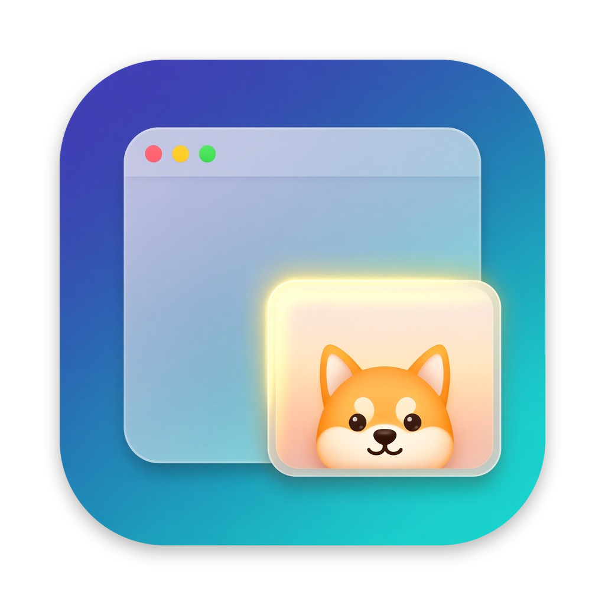

<p align="center"></p>
<h1 align="center">PipDog</h1>
<p align="center"><b>把 Mac 上任意窗口，或窗口里你关心的那一块，变成画中画。</b></p>
<p align="center"><a href="https://github.com/aliyoge/PipDog/releases/latest">下载</a> · <a href="#开始使用">开始使用</a> · <a href="#使用">使用</a> · <a href="#常见问题">常见问题</a></p>
<p align="center"><a href="README.md">English</a> · 简体中文</p>
<p align="center">
  
  
  <a href="LICENSE"></a>
</p>

<!-- 截图 / GIF：有了之后放在这里（例如 docs/images/demo.gif）。 -->

PipDog 在菜单栏运行，把任意窗口、或窗口里的一块区域，变成一个置顶、在每个桌面（Space）都能看到的实时小窗。一边干别的，一边盯着构建日志、聊天、视频或者监控面板。

- **任意窗口，任意区域**：快捷键 PiP 当前窗口，拖出一块区域，或者按住修饰键双击某个面板（日志、聊天列表），只 PiP 那一块。
- **一下切回原窗口**：双击小窗（也可以设成单击）把原窗口提到最前。再双击一次，原窗口被收到屏幕边上，画面照常更新，需要时再点回来。
- **放大、快看、淡出**：滚动或捏合放大到 8 倍，⌥ + 单击用快速查看看原尺寸截图，可调不透明度，也可以让鼠标停在小窗上时自动淡出、点击穿透。
- **不打扰**：小窗从不抢键盘焦点，按显示尺寸抓取画面，默认 10 fps（5–60 可调）。
- **原生、私密**：Swift、AppKit、ScreenCaptureKit，只用公开 API。不用注册账号，不联网，数据不离开你的 Mac。
- **免费开源**，采用 Apache-2.0 协议。

> PipDog 支持简体中文和英文，默认跟随系统语言，可以在「设置… › 通用 › 语言」里切换。

## 开始使用

### 系统要求

| | |
| --- | --- |
| **系统** | macOS 14 Sonoma 或更新 |
| **Mac** | Apple 芯片或 Intel（通用二进制） |

### 1. 安装

1. 从[最新版本](https://github.com/aliyoge/PipDog/releases/latest)下载 `PipDog-<版本>.dmg`（或 `.zip`）。
2. 打开磁盘映像，把 **PipDog** 拖进「应用程序」。开机时启动只对「应用程序」里的 PipDog 生效。
3. 打开 PipDog。图标出现在菜单栏，程序坞里没有图标。

> [!IMPORTANT]
> **提示「“PipDog”已损坏，无法打开」或「无法打开“PipDog”，因为 Apple 无法检查其是否包含恶意软件」**
>
> PipDog 暂未经过 Apple 公证，macOS 的 Gatekeeper 会在第一次打开时拦下它，应用本身没有问题。任选一种方法解决：
>
> **方法一：终端（推荐，所有 macOS 版本都适用）**
>
> ```bash
> xattr -cr /Applications/PipDog.app
> ```
>
> 执行后重新打开 PipDog 即可。这条命令会去掉 macOS 给下载文件加的隔离标记。
>
> **方法二：系统设置**
>
> 1. 先打开一次 PipDog，关掉弹出的警告。
> 2. 打开「系统设置 › 隐私与安全性」，滚到「安全性」，在 PipDog 那一条旁边点「仍要打开」。
> 3. 再点一次「仍要打开」并输入密码。
>
> macOS 14 也可以在「应用程序」里按住 Control 点 PipDog，选「打开」。

### 2. 按提示授权

启动时不会弹任何授权框，每个权限都在第一次用到相关功能时才请求。

| 权限 | 用途 |
| --- | --- |
| **屏幕录制**（macOS 15 起叫「屏幕与系统录音」） | 必需。在小窗里显示窗口的实时画面，第一次 PiP 时请求。授权后要重新启动 PipDog，提示框里有「重新启动 PipDog」按钮。 |
| **辅助功能** | 可选。用于修饰键 + 双击、把具体的原窗口（而不只是它的 app）提到最前、把原窗口移到屏幕边上，以及判断原窗口是否最小化。第一次用到时请求。 |

菜单栏菜单里随时显示两项权限的状态，点未授权的一项就会引导你打开。

### 3. 试一下

切到任意窗口，按 **⌃⌥P**。第一次启动会显示欢迎窗口，列出当前的快捷键和手势；以后可以从菜单「使用说明…」再打开。

## 使用

### 快捷键

以下是默认值，可以在设置里修改（菜单栏 › 设置…，或 ⌘,）。所有操作在菜单里也有。

| 快捷键 | 作用 |
| --- | --- |
| ⌃⌥P | PiP 当前窗口 |
| ⌃⌥⇧P | 框选区域 PiP（Esc 或右键取消） |
| ⌥⇧ + 双击 | PiP 鼠标下方的元素，比如日志面板、聊天列表（需要辅助功能） |
| ⌃⌥⌫ | 关闭所有 PiP |

### 小窗上的操作

| 手势 | 作用 |
| --- | --- |
| 双击（可在设置里改成单击） | 把原窗口提到最前 |
| 原窗口已在最前时再双击 | 把原窗口移到屏幕边上（画面照常更新），再双击移回 |
| ⌥ + 单击 | 用快速查看看原窗口的原尺寸截图 |
| 滚动或捏合 | 以鼠标为中心放大画面，1–8 倍 |
| 拖动 | 移动小窗；放大时是平移画面 |
| ⌘ + 单击 | 恢复原大小 |
| 拖右下角 | 等比缩放小窗 |
| 左上角 ×（鼠标移上去才显示） | 关闭这个 PiP |

- 可以同时开多个 PiP。对同一个窗口或区域再次触发，只会把已有的小窗提到前面。
- 小窗跟着原窗口走：原窗口改变大小时自动调整，原窗口关闭或 app 退出时小窗关闭。
- 原 app 被隐藏（⌘H）时，小窗停在最后一帧并显示「画面暂停」，点小窗即可取消隐藏。原窗口最小化时，小窗显示提示，从程序坞恢复原窗口后继续。
- **悬停时自动隐藏**（默认关闭）：鼠标在小窗上停约 1.5 秒，小窗淡出并让点击穿透到下面的窗口。鼠标移开，或单独按一下 ⌥，小窗就回来。

### 设置

- **快捷键**：点某个动作右边的快捷键，按下新的组合即可。组合里至少要有 ⌘、⌃ 或 ⌥，不能只用 ⌘（或 ⌘⇧）加普通按键，免得抢走 ⌘C、⌘Q 这类常用快捷键。
- **修饰键 + 双击**：可以开关，也可以选要按住的修饰键（默认 ⌥⇧）。
- **帧率**：5、10、15、24、30 或 60 fps（默认 10）。越高越流畅，也越费 CPU。
- **小窗**：单击还是双击切回原窗口（默认双击）、不透明度 30%–100%、悬停时自动隐藏。
- **开机时启动**：使用系统的登录项，菜单栏菜单里也能开关。
- **语言**：跟随系统（默认）、English 或简体中文，修改后会提示重新启动 PipDog。跟随系统时，中文系统显示简体中文，其他系统显示英文。
- **恢复默认**：恢复上面所有设置，开机时启动除外。

## 常见问题

<details>
<summary><b>macOS 提示 PipDog「已损坏」或「无法打开」。</b></summary>

PipDog 暂未公证，被 Gatekeeper 拦下了。在终端执行 `xattr -cr /Applications/PipDog.app` 后重新打开，或者到「系统设置 › 隐私与安全性」点「仍要打开」。详见[安装](#1-安装)。
</details>

<details>
<summary><b>已经授权了屏幕录制，PiP 还是不行？</b></summary>

这个权限要在 app 重新启动后才生效。提示时点「重新启动 PipDog」，或者手动退出再打开。这种情况下菜单里会显示「已授权，需重新启动」。
</details>

<details>
<summary><b>快捷键按了没反应？</b></summary>

可能和其他 app 或系统的快捷键冲突。启动时有快捷键注册失败，PipDog 会提示，设置里那一行也会显示红字；和其他 app 的冲突不一定检测得到。在设置里换一个组合即可。
</details>

<details>
<summary><b>小窗画面停住了，或者关掉了？</b></summary>

- **原窗口已最小化**：从程序坞恢复原窗口，画面就会继续。判断是否最小化需要辅助功能权限。
- **原 app 已隐藏**：点小窗，或切回这个 app，就会取消隐藏。
- 原窗口在其他桌面或最小化时，系统可能停止抓取。这时 PipDog 会关闭小窗并提示；把原窗口恢复后再 PiP 一次。
</details>

<details>
<summary><b>我的窗口去哪了？</b></summary>

原窗口已经在最前时再点小窗，原窗口会被移到屏幕边上，只留 1 点在屏幕内。再点小窗就移回来。关闭这个窗口的最后一个 PiP、或退出 PipDog 时，也会把它放回原位；如果有窗口没能放回，下次启动时会提醒你。
</details>

<details>
<summary><b>开机时启动没生效？</b></summary>

先把 PipDog 移到「应用程序」文件夹。如果系统要求你先允许，设置里会有按钮打开「系统设置 › 通用 › 登录项与扩展」。
</details>

<details>
<summary><b>更新后访达或程序坞还是旧图标？</b></summary>

macOS 会缓存 app 图标。替换「应用程序」里的 app 后运行：

```sh
touch /Applications/PipDog.app
killall Dock; killall Finder
```

还是旧图标的话，用 `sudo rm -rf /Library/Caches/com.apple.iconservices.store` 清掉图标缓存后重启 Mac。
</details>

<details>
<summary><b>PipDog 会录制或上传我的屏幕吗？</b></summary>

不会。画面只在内存里用来绘制小窗。快速查看的截图存成 PNG 放在临时目录，拍下一张或退出 PipDog 时删除。PipDog 不发起任何网络连接。
</details>

## 从源码构建

需要 Xcode 16 或更新（Swift 6）和 [XcodeGen](https://github.com/yonaskolb/XcodeGen)。

```sh
brew install xcodegen
xcodegen generate                    # 从 project.yml 生成 PipDog.xcodeproj
xcodebuild -scheme PipDog -configuration Debug -derivedDataPath build build
open build/Build/Products/Debug/PipDog.app
```

工程按 `Config/Signing.xcconfig` 签名。想用自己的证书或团队，新建一个不提交的 `Config/Signing.local.xcconfig`，在里面设置 `CODE_SIGN_IDENTITY` 和 `DEVELOPMENT_TEAM`。

`./scripts/package.sh` 构建通用二进制的 Release 版，校验签名，并在 `build/dist/` 生成 `PipDog-<版本>.zip` 和 `.dmg`。有 Developer ID 证书时还可以公证：设置 `SIGN_IDENTITY` 和 `NOTARY_PROFILE`。

签名与公证的细节、每个功能的详细行为、设置的存储、图标生成和代码目录见 [docs/DEVELOPMENT.md](docs/DEVELOPMENT.md)；代码约定见 [AGENTS.md](AGENTS.md)。

## 协议

PipDog 采用 [Apache License 2.0](LICENSE) 协议。Copyright 2026 Jody Wong.
